# WURK UP — Complete Technical Manual

**Verified digital work and wage records for India's informal construction workforce**

| | |
| --- | --- |
| Document | WURK UP Complete Technical Manual |
| Version | 1.0 |
| Date of record | 17 November 2026 |
| Repository | `sarthakjain5610/Shramset8.0` |
| Working branch | `arena/ec593218-shramset8-0` (base `main` @ `d85ac8d`) |
| Supabase project | `qpgnoherjkvvasrwjcmf` · region `ap-south-1` · PostgreSQL 17.11 |
| Production URL | `https://wurkup.sarthakjain5610.workers.dev` |
| Programme | Senior Bal Vigyan Innovation · Division II · Indore, Madhya Pradesh |
| Audience | Engineers, operators, auditors and maintainers of the deployment |

> **How to read the status labels used throughout.**
> **Verified active** — observed working in this environment, with a named command or API read as evidence.
> **Configured but unverified** — the configuration exists (in code or in a provider) but no end-to-end proof was executed here.
> **Disabled** — deliberately switched off.
> **Not configured** — no configuration exists.
> **Prototype/demo only** — works, but only on local/demo data; not a production capability.
> **Planned** — designed or requested, not implemented.
> **Unknown** — cannot be determined from the repository or the accessible provider state.

> **Secrets.** This manual records configuration *names* and *states* only. No password, API key, JWT, SMTP credential, anon key or service key appears anywhere in this document, by design.

---

## Table of contents

1. [Introduction, objectives, users and timeline](#1-introduction-objectives-users-and-timeline)
2. [Frontend architecture](#2-frontend-architecture)
3. [Backend architecture](#3-backend-architecture)
4. [Database objects: tables, functions, triggers, constraints, indexes](#4-database-objects-tables-functions-triggers-constraints-indexes)
5. [The seven migrations and their applied status](#5-the-seven-migrations-and-their-applied-status)
6. [RLS, grants, authentication, authorisation and privacy](#6-rls-grants-authentication-authorisation-and-privacy)
7. [Worker and contractor workflows and dashboard data flow](#7-worker-and-contractor-workflows-and-dashboard-data-flow)
8. [Public website, Judge Demo and major modules](#8-public-website-judge-demo-and-major-modules)
9. [Hosting, deployment, GitHub, Cloudflare, DNS, SSL and build](#9-hosting-deployment-github-cloudflare-dns-ssl-and-build)
10. [SMTP, e-mail identity and delivery status](#10-smtp-e-mail-identity-and-delivery-status)
11. [Third-party providers and integrations](#11-third-party-providers-and-integrations)
12. [Environment variables and setup](#12-environment-variables-and-setup)
13. [English/Hindi translation architecture](#13-englishhindi-translation-architecture)
14. [Testing architecture, commands and results](#14-testing-architecture-commands-and-results)
15. [Security, privacy, limitations, financial-write restrictions](#15-security-privacy-limitations-financial-write-restrictions)
16. [Maintenance, troubleshooting, deployment, rollback](#16-maintenance-troubleshooting-deployment-rollback)
17. [Pending features, disabled functionality, roadmap](#17-pending-features-disabled-functionality-roadmap)
18. [Glossary, references and change history](#18-glossary-references-and-change-history)

**Appendices:** A — file map · B — incident record (42501 outage) · C — figure and table indexes

---

## 1. Introduction, objectives, users and timeline

### 1.1 What WURK UP is

WURK UP is a bilingual (English/Hindi) web application that gives a daily-wage construction
worker a durable, tamper-evident record of the work they performed and the money they are owed.
A worker registers once and receives a reusable QR pass that carries **no personal data** — only an
opaque reference token. Each shift is then recorded through a mutual approval step: the site
requests the shift, the worker approves it from their own device, the statutory wage engine prices
it in integer paise, and a SHA-256 hash chain seals the sequence. Contractors get the mirror image:
a live muster, an assignment-scoped crew view, and a wage liability picture that is computed rather
than asserted.

The product is deliberately **not** a job board, a payment gateway or a government portal. It is an
evidence layer. Everything that would require a financial write (payout, adjustment, refund) or a
government filing is either absent, explicitly labelled *not connected*, or recorded as an internal
WURK UP record with a visible disclaimer.

### 1.2 Objectives

| # | Objective | How it is met in the code | Status |
| --- | --- | --- | --- |
| O1 | A worker can prove a shift happened | mutual approval + hash-chained attendance record | Verified active (SQL + render evidence) |
| O2 | Neither party can silently rewrite history | determinism + predecessor hash pointers, audit bench | Prototype/demo only (bench operates on demo data) |
| O3 | Wage maths is statutory, not opinion | integer-paise engine with MP Minimum Wages bands | Verified active (60 core tests) |
| O4 | The worker's identity is not in the QR code | opaque token only, resolution server-side | Verified active (code + tests) |
| O5 | A Hindi reader never sees an English wall | typed bilingual dictionaries, strict audit script (0 hardcoded strings) | Verified for coverage (§13); copy not yet proofread (§15.4 L3) |
| O6 | No private data reaches a contractor without consent | column grants + SECURITY DEFINER RPC + consent flag | Verified active (RLS regression tests) |
| O7 | Nothing pretends to be an official filing | disclaimer in the grievance flow, internal reference format | Verified active (189 dashboard checks) |

### 1.3 Users and roles

| Role | Who | Can read | Can write | Cannot |
| --- | --- | --- | --- | --- |
| Anonymous | public visitor, QR scanner | public pages, `/verify` pass resolution | — | any business table |
| Worker | registered worker | own `workers` row, own attendance, ledger, disputes, approvals | insert own dispute; update own approval (`status`, `responded_at`) | read another worker's rows; read `workers.user_id`; read private data of others |
| Contractor | registered contractor account | assigned workers' directory rows, assigned attendance/ledger/disputes | insert an approval request (status `pending`) | write attendance, wage rates, payments; respond to disputes; see private identifiers without consent |
| Support / operator | human support desk | nothing beyond what the app shows | — (no admin console exists) | database access through the product |
| Judge | evaluator | everything in the isolated demo workspace | only demo-scoped local state | any production row |

### 1.4 Feature summary

Public marketing site, six-step explainer, about/privacy/help pages, pass verification, registration,
sign-in, password recovery, worker dashboard (overview, attendance, wages, approvals, disputes,
profile), contractor dashboard (overview, crew, sites, attendance, wages, approvals, disputes),
an isolated Judge Demo with a cryptographic audit bench, an anomaly engine, a bilingual copy system,
and a four-tier test suite. Details in §8.

### 1.5 Development timeline (from Git history, verified)

| Date (UTC) | Commit | Event |
| --- | --- | --- |
| 2026-10-25 | `20261025000000_shram_setu_schema.sql` | Baseline schema: 11 tables, RLS enabled, no client policies |
| 2026-10-31 | `20261031000000_auth_rls_corrections.sql` | Client policies + first table-wide grants |
| 2026-10-31 | `20261031120000_worker_private_data_security.sql` | Private data table split; column grants replace table grants |
| 2026-11-02 | `20261102000000_harden_security_definer_search_path.sql` | SECURITY DEFINER hardening |
| 2026-11-02 | `20261102010000_worker_onboarding_rpc.sql` | Onboarding RPC |
| 2026-11-02 | `20261102120000_worker_onboarding_conflict_target_fix.sql` | Conflict-target fix |
| 2026-11-07 | `d85ac8d` | `main`: merge of PR #10 (current base) |
| 2026-11-08 | PR #11 opened (`f69ccc5`) | Authentication, registration, password recovery |
| 2026-11-17 | `e3b4817` | Worker + Contractor dashboards on live Supabase (PR #12) |
| 2026-11-17 | `2fd71a4` | Grievance references become internal `WU-DSP-…` records |
| 2026-11-17 | `8d473fc` | Wage-benchmark wording softened to a non-legal note |
| 2026-11-17 | `231fa4f` | Web Crypto required for grievance references (no `Math.random` fallback) |
| 2026-11-17 | `20261117120000_worker_identity_rls_helpers.sql` | **42501 outage fix** (this manual's primary incident) |

The first commit on this branch is a merge commit of `main`; the branch carries two feature commits
of its own (PR #12) before the current work. The repository has never been force-pushed and PR #11
and PR #12 remain separate.

---

## 2. Frontend architecture

### 2.0 Where the system sits

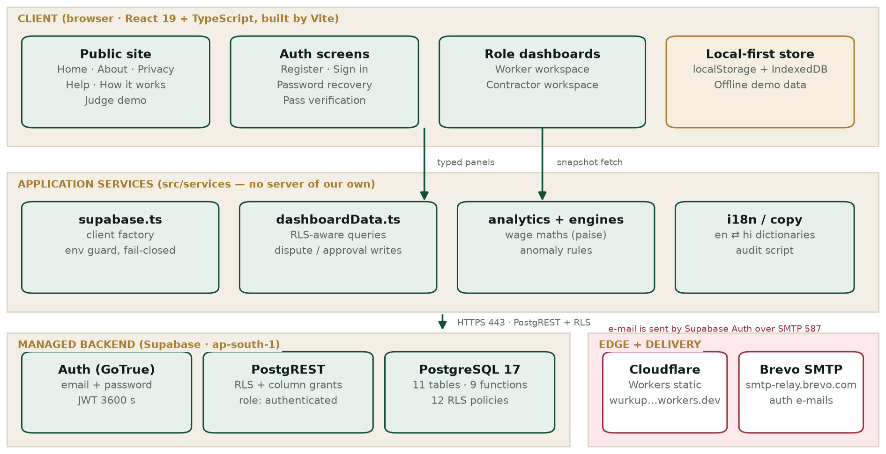

### 2.1 Runtime shape

The application is a **single-page React application with hash routing and no custom server**.
Every screen is client-rendered; the only network dependency is Supabase (REST over HTTPS). When
Supabase is not configured, the app still boots and renders an explicit "not configured" state
instead of failing silently.

| Layer | Location | Responsibility |
| --- | --- | --- |
| Root shell | `src/App.tsx` | route state, language state, auth session, data-store hydration, modals |
| Routing | `src/services/router.ts` | hash routes, params, back/forward, `not-found` fallback |
| Session | `src/services/auth.ts` | `signUp`, `signIn`, `signOut`, `resetPasswordForEmail`, `onAuthStateChange` |
| Language | `src/services/i18n.ts` | typed `translations.en` / `.hi`, `t()`, persistence |
| Public copy | `src/services/publicCopy.ts` | navigation, hero, CTA, footer strings |
| Dashboard copy | `src/components/dashboard/dashboardCopy.ts` | typed dictionary for 13 panels, en ⇄ hi parity enforced by the compiler |
| Data | `src/services/dashboardData.ts` | the entire RLS-aware read/write surface |
| Analytics | `src/services/dashboardAnalytics.ts` | integer-paise maths, labels, trends |
| Local store | `src/services/indexedDB.ts`, `src/services/db.ts` | offline-first demo dataset |
| UI kit | `src/components/ui/*`, `src/components/dashboard/ui.tsx` | buttons, panels, notices, tables, modals |

### 2.2 Component and routing structure

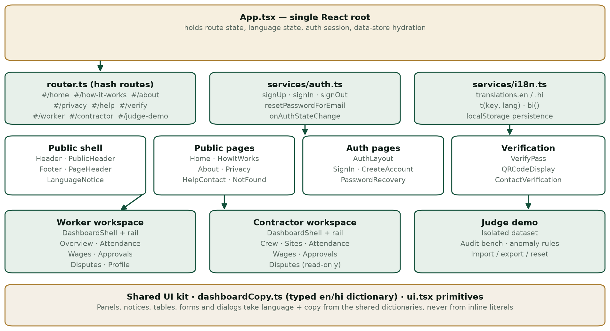

| Route | Component | Guard | Notes |
| --- | --- | --- | --- |
| `#/home` | `public/Home.tsx` | none | hero pass preview, portal choice, workflow, guarantees, FAQ |
| `#/how-it-works` | `public/HowItWorks.tsx` | none | six-step custody chain |
| `#/about` | `public/About.tsx` | none | origin story, principles, welfare alignment |
| `#/privacy` | `public/Privacy.tsx` | none | what is encoded, what is never collected |
| `#/help` | `public/HelpContact.tsx` | none | helpline, emergency guidance, contact form |
| `#/create-account` | `public/CreateAccount.tsx` | none | register (worker/contractor) |
| `#/sign-in` | `public/SignIn.tsx` | none | credentials, judge-demo entry |
| `#/forgot-password` | `public/PasswordRecovery.tsx` | none | request + recovery states |
| `#/verify?refToken=…` | `public/VerifyPass.tsx` | none | public pass resolution |
| `#/worker` | `worker/WorkerPortal.tsx` → `dashboard/worker/*` | session + role | six worker panels |
| `#/contractor` | `contractor/ContractorDashboard.tsx` → `dashboard/contractor/*` | session + role | seven contractor panels |
| `#/judge-demo` | `JudgeDemoTourModal.tsx` + demo workspace | explicit entry | isolated data, audit bench |
| anything else | `public/NotFound.tsx` | none | friendly 404, never a silent redirect |

### 2.3 Languages and state

Language is a single value in `App.tsx`, seeded from `getSavedLanguage()` and persisted to
`localStorage` under `shramsetu_preferred_lang`, so a refresh or a route change keeps the choice.
Components receive `lang` as a prop; nothing re-reads storage mid-render. The typed dictionaries
make a missing key a **compile error** (`TranslationKey = keyof typeof translations.en`), and the
`dashboardCopy` module additionally enforces en ⇄ hi parity at the type level.

### 2.4 Build toolchain and dependency inventory

Built with Vite 8 (Rolldown pipeline, Tailwind v4 via `@tailwindcss/vite`). There is **no** Next.js,
no server runtime and no server-side rendering in production; the SR tests use `react-dom/server`
only inside the test harness.

| Package | Version | Role | Status |
| --- | --- | --- | --- |
| `react`, `react-dom` | 19.0.1 | UI runtime | Verified active |
| `vite` | 8.3.0 | bundler/dev server | Verified active |
| `typescript` | 7.0.2 | type checking (`npm run lint`) | Verified active |
| `tailwindcss`, `@tailwindcss/vite` | 4.3.3 | styling | Verified active |
| `@supabase/supabase-js` | 2.118.0 | auth + REST client | Verified active |
| `lucide-react` | 0.546.0 | icon set | Verified active |
| `motion` | 12.23.24 | transitions | Verified active |
| `qrcode` / `jsqr` | 1.5.4 / 1.4.0 | pass generation / camera scan | Verified active |
| `jsdom` | 30.1.3 | component tests | Verified active (tests only) |
| `tsx` | 4.21.0 | runs the TS test scripts | Verified active |
| `express` | 4.21.2 | leftover local server entry | Not configured (no production use) |
| `@google/genai` | 2.4.0 | declared dependency | Not configured (not imported anywhere in `src`) |
| `@fontsource-variable/*` | 5.3.x | self-hosted fonts (Fraunces, JetBrains Mono, Noto Sans Devanagari, Plus Jakarta Sans) | Verified active |

---

## 3. Backend architecture

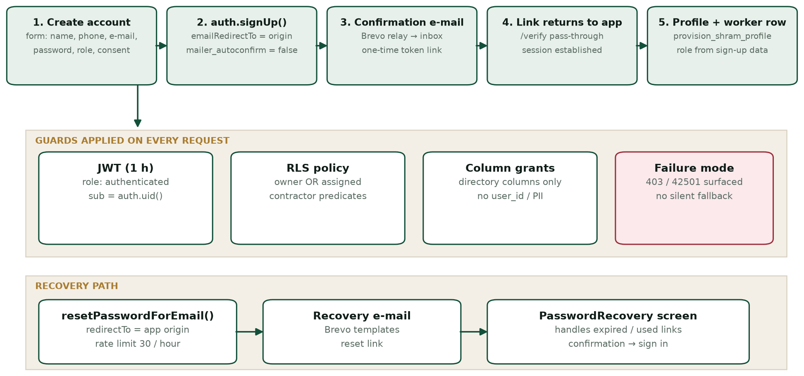

### 3.1 What exists, and what does not

WURK UP has **no backend service of its own**. There is no Express API in production, no edge
function, no cron job and no queue. The backend is the managed Supabase project, used exactly as
shipped:

| Component | Product | What it does here | Status |
| --- | --- | --- | --- |
| Authentication | Supabase Auth (GoTrue) | email + password, JWT (3600 s), e-mail confirmation, password recovery | Verified active |
| API | PostgREST | table REST endpoints, RLS enforcement, column-level privileges | Verified active |
| Database | PostgreSQL 17.11 | 11 tables, 12 policies, 9 functions | Verified active |
| Storage | — | not used | Not configured |
| Edge functions | — | none deployed (verified via provider tooling) | Not configured |
| Realtime | — | not used; the app refetches explicitly | Not configured |

### 3.2 Authentication lifecycle

1. `signUp({ email, password, options.data })` using `emailRedirectTo = window.location.origin`.
2. GoTrue sends a confirmation e-mail through the configured SMTP relay; `mailer_autoconfirm`
   is **false**, so no session exists until the link is opened.
3. Opening the link returns the user to the app origin; the client receives a session and calls
   `onAuthStateChange`.
4. A trigger (`provision_shram_profile`) creates the `profiles` row with the role taken from the
   sign-up metadata.
5. A worker without a `workers` row is routed to onboarding, which calls the
   `complete_my_worker_onboarding(trade, skill_level)` RPC.
6. `resetPasswordForEmail(email, { redirectTo })` drives the recovery flow below: the link
   returns the user to the allow-listed origin with a recovery token, the client calls
   `updateUser({ password })`, and `PasswordRecovery.tsx` distinguishes expired links, completed
   resets and invalid links instead of failing silently.

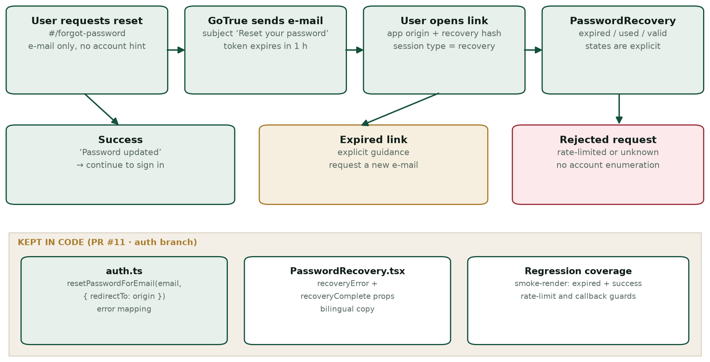

### 3.3 API contract used by the browser

Only table reads/writes and four RPCs are used. There are no custom endpoints to maintain.

| Call | Direction | Authorisation relied on |
| --- | --- | --- |
| `select` on `workers`, `sites`, `attendance_records`, `wage_ledger_entries`, `disputes`, `approval_requests`, `contractor_worker_assignments`, `profiles` | read | RLS policies + column grants |
| `insert` on `disputes` | write | `dispute_worker_create` (owner only) |
| `insert` on `approval_requests` | write | `approval_contractor_create` (assigned contractor, `pending` only) |
| `update` on `approval_requests` (`status`, `responded_at`) | write | `approval_worker_respond` (owner, pending only) |
| `rpc get_worker_private_data(p_worker_id)` | read | SECURITY DEFINER, owner only |
| `rpc get_assigned_worker_contact(p_worker_id)` | read | SECURITY DEFINER, assignment **and** consent |
| `rpc set_my_worker_contact_sharing(p_enabled)` | write | SECURITY DEFINER, owner only |
| `rpc complete_my_worker_onboarding(p_trade, p_skill_level)` | write | SECURITY DEFINER, `auth.uid()` |

### 3.4 Failure semantics

Every data function maps provider errors through `classifyDataError()` into a typed
`DashboardError` (`not_configured`, `offline`, `unauthorized`, `not_found`, `validation`,
`network`, `unknown`). The UI always renders an explicit message; there is no silent fallback to
demo data in a real account, and no write is attempted when the reference generator cannot obtain
secure randomness.

---

## 4. Database objects: tables, functions, triggers, constraints, indexes

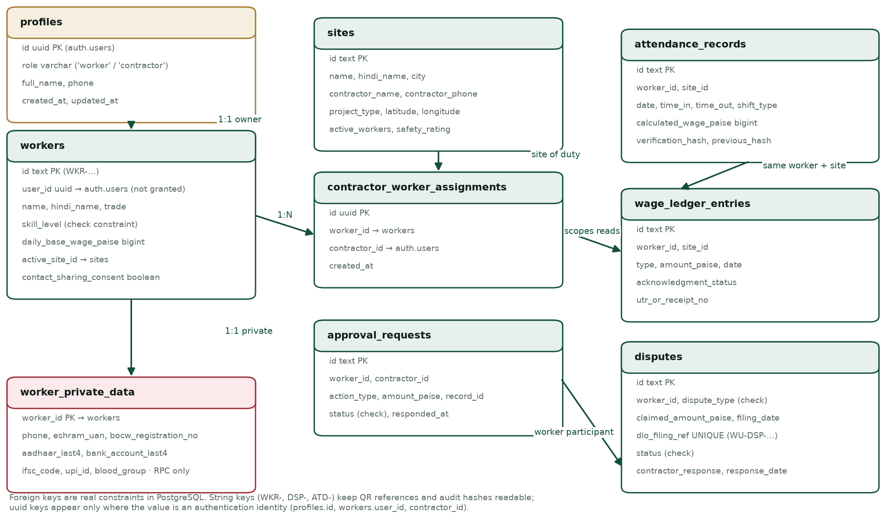

> Nineteen foreign keys tie the ten business tables to `auth.users`; six of them cascade on delete.
> Private identifiers are deliberately in a separate table so that a directory read can never
> return them.

### 4.1 Tables (11, verified from `information_schema.tables`)

| Table | Primary key | Key columns | Purpose | Access pattern |
| --- | --- | --- | --- | --- |
| `profiles` | `id uuid` (= `auth.users.id`) | `role`, `full_name`, `phone`, timestamps | one row per authenticated account | self read |
| `workers` | `id text` (`WKR-…`) | `user_id`, `name`, `hindi_name`, `trade`, `skill_level`, `daily_base_wage_paise`, `active_site_id`, `contact_sharing_consent` | directory identity of a worker | directory columns only |
| `worker_private_data` | `worker_id text` → `workers` | `phone`, `eshram_uan`, `bocw_registration_no`, `aadhaar_last4`, `bank_account_last4`, `ifsc_code`, `upi_id`, `blood_group` | private identifiers | **RPC only** |
| `sites` | `id text` | `name`, `hindi_name`, `city`, `location`, `contractor_name/phone`, `project_type`, `latitude`, `longitude`, `active_workers`, `safety_rating` | construction site registry | assignment-scoped read |
| `contractor_worker_assignments` | `id uuid` | `worker_id`, `contractor_id` (= `auth.users.id`), `created_at` | the authorisation edge | contractor reads own |
| `attendance_records` | `id text` | `worker_id`, `site_id`, `date`, `time_in/out`, `shift_type`, `base_hours`, `overtime_hours`, `calculated_wage_paise`, `status`, `verification_hash`, `previous_hash`, `geo_verified` | one row per approved shift | participant read |
| `wage_ledger_entries` | `id text` | `worker_id`, `site_id`, `date`, `type`, `amount_paise`, `payment_mode`, `status`, `acknowledgment_status`, `utr_or_receipt_no` | credit/payout/deduction ledger | participant read |
| `disputes` | `id text` (`DSP-…`) | `worker_id`, `dispute_type` (check), `claimed_amount_paise`, `incident_date`, `filing_date`, `description`, `status` (check), `dlo_filing_ref` **UNIQUE**, `evidence_muster_count`, `contractor_response` | worker grievance record | owner read/insert; participant read |
| `approval_requests` | `id text` | `worker_id`, `contractor_id`, `action_type`, `amount_paise`, `record_id`, `status`, `responded_at` | the mutual-approval handshake | participant read; contractor insert; worker update |
| `qr_credentials` | `id` | `worker_id`, `credential_hash`, `revoked_at`, `replaced_by` | opaque pass tokens | service role only |
| `audit_events` | `id` | `entity_type`, `entity_id`, `action`, `actor_id`, `actor_role`, `canonical_payload`, `hash`, `previous_hash`, `sequence_number` | hash-chain event log | service role only |

### 4.2 Functions (9, verified from `pg_proc`)

| Function | Kind | Security | Purpose |
| --- | --- | --- | --- |
| `get_worker_private_data(text)` | RPC | SECURITY DEFINER | returns the caller's own private row |
| `get_assigned_worker_contact(text)` | RPC | SECURITY DEFINER | returns phone only for an assigned worker who consented |
| `set_my_worker_contact_sharing(boolean)` | RPC | SECURITY DEFINER | flips the consent flag for the caller |
| `complete_my_worker_onboarding(text, text)` | RPC | SECURITY DEFINER | creates/returns the caller's `workers` row |
| `is_current_worker(text)` | predicate | SECURITY DEFINER | **new in v1.0 fix** — does the caller own this worker row |
| `is_assigned_contractor(text)` | predicate | SECURITY DEFINER | **new in v1.0 fix** — is the caller the assigned contractor |
| `can_read_worker(text)` | predicate | SECURITY DEFINER | **new in v1.0 fix** — OR of the two above |
| `provision_shram_profile()` | trigger | SECURITY DEFINER | creates `profiles` on `auth.users` insert |
| `rls_auto_enable()` | utility | invoker | Supabase helper present in the project |

All three new predicates are `STABLE`, `SET search_path = ''`, return **boolean only**, and are
granted to `authenticated` with `anon`/`PUBLIC` revoked.

### 4.3 Triggers

| Trigger | Table | Function | Effect |
| --- | --- | --- | --- |
| on `auth.users` insert | `auth.users` | `provision_shram_profile()` | creates the `profiles` row with role metadata |

No trigger writes business rows silently; attendance, ledger and dispute rows are always created by
an explicit client call.

### 4.4 Constraints (verified from `pg_constraint`)

| Table | Constraint | Definition |
| --- | --- | --- |
| `disputes` | `disputes_dispute_type_check` | `dispute_type ∈ {unpaid_wages, arbitrary_deduction, denied_overtime, unsafe_conditions, bocw_benefit_denial}` |
| `disputes` | `disputes_status_check` | `status ∈ {submitted, under_inquiry, notice_issued, settled}` |
| `disputes` | `disputes_dlo_filing_ref_key` | `UNIQUE (dlo_filing_ref)` — no format check, which is why `WU-DSP-…` values insert cleanly |
| `disputes` | `disputes_worker_id_fkey` | → `workers(id)` `ON DELETE RESTRICT` |
| `contractor_worker_assignments` | `…_worker_id_fkey`, `…_contractor_id_fkey` | → `workers(id)`, → `auth.users(id)` |
| `approval_requests` | status/type checks + worker/contractor FKs | same participant model |

### 4.5 Indexes

The schema relies on primary keys and unique constraints only. Verified index list:
`workers_pkey`, `workers_user_id_key`, `disputes_pkey`, `disputes_dlo_filing_ref_key`,
`attendance_records_pkey` (and the equivalent PK indexes on the remaining tables). **No secondary
index exists** on `attendance_records(worker_id, date)`, `wage_ledger_entries(worker_id, date)` or
`approval_requests(status)`; at current row counts this is irrelevant, and it is listed in §17 as a
planned optimisation rather than an outstanding defect.

### 4.6 Views

None. The project exposes no views; every read goes through a table with RLS or a function.
---

## 5. The seven migrations and their applied status

Migration history was read from `supabase_migrations.schema_migrations` before any change was
proposed (as required). At the start of this work the table held **exactly six** rows, matching the
six files in `supabase/migrations/`. Nothing was reapplied, edited or reset.

| # | Version | File | Purpose | Applied |
| --- | --- | --- | --- | --- |
| 1 | `20261025000000` | `shram_setu_schema.sql` | baseline: 11 tables, enums via check constraints, RLS enabled, **no** client grants or policies | Yes (pre-existing) |
| 2 | `20261031000000` | `auth_rls_corrections.sql` | participant policies, `profiles` policy, first table-wide grants to `authenticated` | Yes (pre-existing) |
| 3 | `20261031120000` | `worker_private_data_security.sql` | splits private identifiers into `worker_private_data`, revokes table-wide grants on `workers`, re-grants directory columns, adds the three private-data RPCs | Yes (pre-existing) |
| 4 | `20261102000000` | `harden_security_definer_search_path.sql` | pins `search_path` on the SECURITY DEFINER functions | Yes (pre-existing) |
| 5 | `20261102010000` | `worker_onboarding_rpc.sql` | `complete_my_worker_onboarding()` | Yes (pre-existing) |
| 6 | `20261102120000` | `worker_onboarding_conflict_target_fix.sql` | fixes the `ON CONFLICT` target of that RPC | Yes (pre-existing) |
| 7 | `20261117120000` | `worker_identity_rls_helpers.sql` | **new**: three `SECURITY DEFINER` predicates and six policy replacements that remove the dependency on `workers.user_id` | Yes (applied and recorded in this work) |

**Why migration 7 was necessary and why it is additive.** Migration 3 revoked the table-wide
`SELECT` on `workers` and granted only the directory columns; `user_id` was intentionally excluded.
But six policies on four other tables still filtered through `EXISTS (SELECT 1 FROM workers w
WHERE w.user_id = auth.uid())`. Policy subqueries run with the *calling* role's privileges, so every
dashboard read of attendance, ledger, disputes and approvals failed with SQLSTATE 42501 while a
direct read of `workers` succeeded. Migration 7 replaces those six policies with calls to boolean
predicates that execute as the table owner. It creates objects and replaces policies; it does not
alter a column, drop data, touch `auth`, or re-run anything from migrations 1–6.

**Evidence that the fix is live** (see Appendix B): the 42501 reproduction ran before and after the
migration against the real project, using the exact role and JWT claims PostgREST uses.

| Probe (role `authenticated`, worker claims) | Before migration 7 | After migration 7 |
| --- | --- | --- |
| `SELECT … FROM public.workers` | OK (1 row) | OK (1 row) |
| `SELECT … FROM public.attendance_records` | **42501** | OK |
| `SELECT … FROM public.wage_ledger_entries` | **42501** | OK |
| `SELECT … FROM public.disputes` | **42501** | OK |
| `SELECT … FROM public.approval_requests` | **42501** | OK |
| `SELECT … FROM public.sites` | OK | OK |
| `SELECT … FROM public.contractor_worker_assignments` | OK | OK |

---

## 6. RLS, grants, authentication, authorisation and privacy

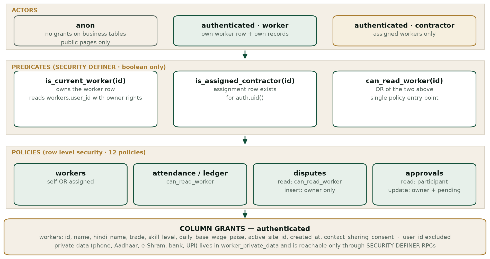

### 6.1 The three actors

| Actor | JWT role | Sees |
| --- | --- | --- |
| anonymous visitor | `anon` | nothing in the business schema (no grants at all) |
| worker | `authenticated` | own `workers` row, own attendance, ledger, disputes, approvals; own private data via RPC |
| contractor | `authenticated` | assigned `workers` rows, their attendance/ledger/disputes; approval requests they created |

Authorisation is **never** decided in the React code. The client always issues a query for the data it
wants, without a `user_id` filter, and lets PostgreSQL decide; the only client-side guard is the
convenience check that exactly one worker row is visible (`>1` produces a hard error rather than a
guess).

### 6.2 Policies (12, verified from `pg_policies`)

| Table | Policy | Command | Rule (after migration 7) |
| --- | --- | --- | --- |
| `workers` | `worker_self_read` | SELECT | `user_id = auth.uid()` |
| `workers` | `worker_assigned_read` | SELECT | assignment exists for `auth.uid()` |
| `sites` | `site_assigned_read` | SELECT | assignment whose worker's `active_site_id` matches |
| `attendance_records` | `attendance_participant_read` | SELECT | `can_read_worker(worker_id)` |
| `wage_ledger_entries` | `ledger_participant_read` | SELECT | `can_read_worker(worker_id)` |
| `disputes` | `dispute_participant_read` | SELECT | `can_read_worker(worker_id)` |
| `disputes` | `dispute_worker_create` | INSERT | `is_current_worker(worker_id)` |
| `approval_requests` | `approval_participant_read` | SELECT | `contractor_id = auth.uid() OR is_current_worker(worker_id)` |
| `approval_requests` | `approval_contractor_create` | INSERT | assigned contractor, `status = 'pending'` |
| `approval_requests` | `approval_worker_respond` | UPDATE | owner, `status = 'pending'` → one of three outcomes |
| `contractor_worker_assignments` | `assignment_participants_read` | SELECT | `contractor_id = auth.uid()` |
| `profiles` | `profile_self_read` | SELECT | `id = auth.uid()` |

### 6.3 Column grants (the privacy boundary)

`authenticated` holds `SELECT` on exactly these `workers` columns:

```
id, name, hindi_name, trade, skill_level, daily_base_wage_paise,
active_site_id, created_at, contact_sharing_consent
```

`user_id` is **not** granted. Neither is any private identifier, because those columns do not exist
on `workers` at all — they live in `worker_private_data`, which has **no** grant to `authenticated`
and is reachable only through `get_worker_private_data()` / `get_assigned_worker_contact()`.

| Data class | Where it lives | How a browser can obtain it |
| --- | --- | --- |
| Worker name, trade, skill, base wage, site | `workers` | directory `SELECT` |
| Worker phone | `worker_private_data` | owner RPC, or contractor RPC **with active consent** |
| Aadhaar last-4, e-Shram UAN, BOCW number, bank account, IFSC, UPI, blood group | `worker_private_data` | owner RPC only |
| Attendance, ledger, disputes, approvals | their own tables | participant policies |
| QR credential hashes, audit events | `qr_credentials`, `audit_events` | no client grant (service role only) |

### 6.4 Consent mechanics

`workers.contact_sharing_consent` defaults to `false`. A worker flips it through
`set_my_worker_contact_sharing(true)`. `get_assigned_worker_contact()` returns the phone only when
the caller is assigned **and** the flag is true, and returns `NULL` (not an error, not a placeholder)
otherwise. The contractor UI renders "consent not given" rather than an empty string.

### 6.5 Regression tests for the permission model

Two independent layers, both new in this work:

1. `supabase/tests/rls_permissions.sql` — nine scenario groups executed inside a rolled-back
   transaction against the live project: worker reads, worker ownership predicates, own-dispute
   insert, foreign-dispute rejection (42501), unrelated account (zero rows everywhere), assigned
   contractor reads, contractor dispute-insert rejection, private-column denial.
   **Result: all nine groups passed** (Appendix B has the transcript).
2. `scripts/rls-contract-test.ts` — 37 static checks over the migration files, so a future migration
   cannot reintroduce the pattern: no policy may embed a `workers.user_id` subquery, the predicates
   must stay `SECURITY DEFINER` with an empty `search_path`, `workers` must never receive a
   table-wide `SELECT`, `user_id` must never appear in a column grant, RLS must never be disabled.

---

## 7. Worker and contractor workflows and dashboard data flow

### 7.1 Worker onboarding

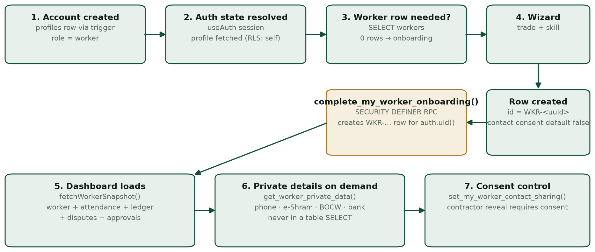

1. Account creation and e-mail confirmation (§3.2) produce a `profiles` row with `role = 'worker'`.
2. The dashboard calls `fetchWorkerSnapshot()`, which reads `workers` with the directory projection
   and `LIMIT 2`.
3. Zero rows → `{ status: 'needs_onboarding' }` → the wizard asks only for trade and skill level.
4. The wizard calls `complete_my_worker_onboarding(trade, skill_level)`; the RPC derives the id
   (`WKR-<uuid>`), sets `user_id = auth.uid()` and returns the id.
5. The same snapshot function is retried; the dashboard renders six panels.
6. Private details are fetched only when the profile panel is opened, through the owner RPC.

### 7.2 Worker dashboard data flow

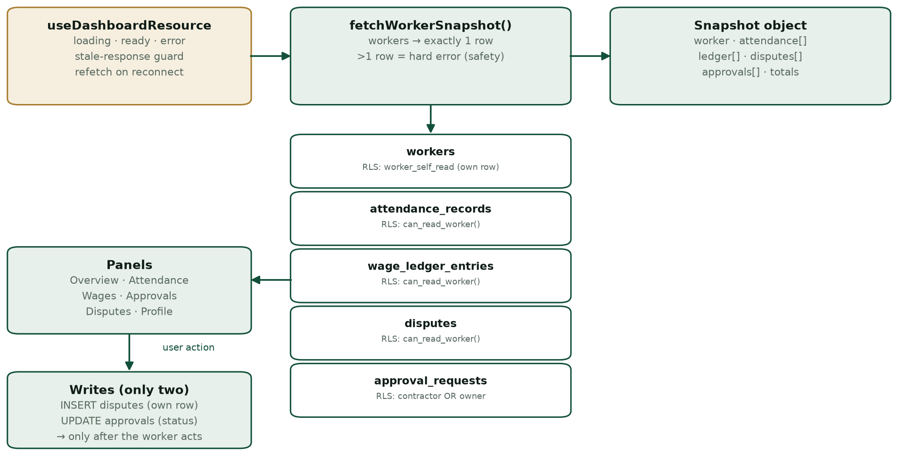

| Step | Code | Notes |
| --- | --- | --- |
| Load | `useDashboardResource(fetchWorkerSnapshot)` | loading / ready / error, stale-response guard, refetch on reconnect |
| Read | five parallel queries | `workers` → attendance, ledger, disputes, approvals |
| Derive | `dashboardAnalytics` | integer paise, signed balances, 14-day rhythm, month filters |
| Render | six panels | overview, attendance, wages, approvals, disputes, profile |
| Write | two operations only | file a dispute; respond to an approval |
| Fail | `DashboardError` | explicit message, no silent demo data |

**Reference generation.** A dispute stores a WURK UP reference in the deployed column
`dlo_filing_ref` (kept for compatibility). The value is `WU-DSP-YYYYMMDD-XXXXXXXXXX`, generated by
`buildSubmissionReference()` from `crypto.getRandomValues` over a 32-symbol alphabet (no `I`/`O`).
If Web Crypto is unavailable the function throws `SubmissionReferenceError`, the write is aborted and
the user is told nothing was saved — there is deliberately no `Math.random()` fallback, because a
guessable reference would expose another worker's record id.

### 7.3 Contractor dashboard data flow

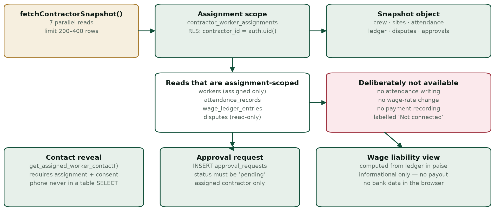

| Step | Code | Notes |
| --- | --- | --- |
| Load | `fetchContractorSnapshot()` | seven parallel reads, 200–400 row caps |
| Scope | RLS | only assigned workers, their sites, attendance, ledger, disputes |
| Reveal | `get_assigned_worker_contact()` | requires assignment **and** consent |
| Write | insert `approval_requests` | `contractor_id = auth.uid()`, `status = 'pending'` |
| Not available | attendance writing, wage-rate change, payment recording, dispute response | each rendered as an explicit "Not connected" affordance |

### 7.4 Mutual approval handshake

1. Contractor scans the pass (or pastes the reference) and requests a shift.
2. `approval_requests` row is created with `status = 'pending'` — no attendance row yet.
3. The worker sees the request, confirms date, site, hours and rate, and approves.
4. Only then is a priced attendance row written; the ledger follows the pricing.
5. A rejection or "reported suspicious" closes the request with `responded_at` and leaves no wage row.

Because step 4 requires the worker's own action, a contractor cannot manufacture a shift.

---

## 8. Public website, Judge Demo and major modules

| Module | What it does | Notable implementation detail | Status |
| --- | --- | --- | --- |
| Home | hero pass preview, portal choice, four-step chain, guarantees, FAQ | copy from `publicCopy` + inline bilingual `tr()`; pass preview is a stylised, non-scannable sample | Verified active |
| How it works | six-step custody chain of a shift | step data is authored in both languages | Verified active |
| About | origin story, four design principles, welfare alignment | explains that registration with e-Shram/BOCW remains separate | Verified active |
| Privacy | what the QR encodes, what is never collected, data-retention statements | encodes only an opaque token + issue date + checksum | Verified active |
| Help & contact | helpline, emergency 112 guidance, message form | form stores locally for the support desk; no provider integration | Prototype/demo only |
| Pass verification | resolves `?refToken=` to a directory record | public route, no private data returned | Verified active |
| Registration | worker/contractor sign-up with consent checkbox | Supabase `signUp`, confirmation required | Verified active |
| Sign-in | email + password, judge-demo entry | rate-limit messaging | Verified active |
| Password recovery | request + recovery screen | expired / completed / invalid states | Verified active |
| Worker dashboard | six panels | see §7.2 | Verified active |
| Contractor dashboard | seven panels | see §7.3 | Verified active |
| Grievance flow | record a wage grievance with evidence count | internal `WU-DSP-…` reference, bilingual non-filing disclaimer, legacy badge for old rows | Verified active |
| Judge demo | isolated dataset, audit bench, anomaly rules, import/export/reset | never touches a real account; demo rows are flagged `isDemoRecord` | Prototype/demo only |
| Wage engine | statutory bands, pro-rata overtime, integer paise | 60 core tests | Verified active |
| Anomaly engine | RULE-01…RULE-07 with neutral explanations | operates on demo data | Prototype/demo only |
| Audit chain | SHA-256 predecessor pointers | verification runs on demo data | Prototype/demo only |

### 8.1 Judge Demo isolation

The demo workspace is entered explicitly (`#/judge-demo` or the header action), hydrates a fixture
dataset into the local store, and labels every row. Export produces JSON; import validates shape;
reset restores the fixture. No demo write is ever sent to Supabase: the demo path uses the local
repository (`src/services/db.ts`), while the authenticated dashboards use `dashboardData.ts`. This
separation is the reason a judge can exercise destructive actions safely.

---

## 9. Hosting, deployment, GitHub, Cloudflare, DNS, SSL and build

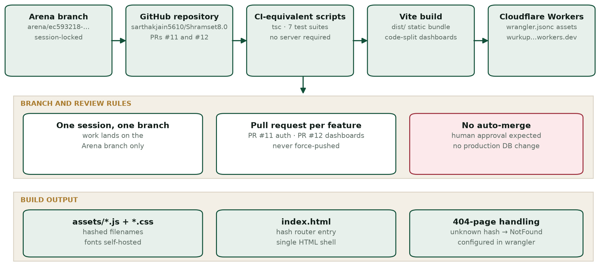

### 9.1 Hosting

| Item | Value | Status |
| --- | --- | --- |
| Host | Cloudflare Workers static assets | Verified active (configuration + site URL) |
| Worker name | `wurkup` (`wrangler.jsonc`) | Verified active |
| Assets directory | `./dist` | Verified active |
| SPA fallback | `not_found_handling: "404-page"` | Verified active |
| Compatibility date | `2026-11-04` | Verified active |
| Production URL | `https://wurkup.sarthakjain5610.workers.dev` | Verified active (also the configured Supabase `site_url`) |
| Custom domain | none configured in the repository | Not configured |
| DNS | `*.workers.dev` is managed by Cloudflare | Verified active |
| TLS | Cloudflare edge certificate on the workers.dev hostname | Verified active |
| Build command | `npm run build` → `vite build` → `dist/` | Verified active |
| Deploy command | Cloudflare Workers Git integration or `wrangler deploy` | Configured but unverified in this environment |

### 9.2 Build process

```
npm ci                # deterministic install
npx tsc --noEmit      # type gate (also `npm run lint`)
npm run build         # vite build → dist/ (hashed assets, code-split dashboards)
# deploy: wrangler deploy (assets upload) — not executed here
```

The build emits a single hashed JS/CSS graph, self-hosted variable fonts (including Noto Sans
Devanagari, so Hindi never falls back to a system font), and one `index.html`. Dashboards are
code-split, which is why the main bundle stays under the warning threshold for the public pages.

### 9.3 GitHub and review flow

| Item | Value |
| --- | --- |
| Repository | `sarthakjain5610/Shramset8.0` |
| Default branch | `main` (`d85ac8d`) |
| Open pull requests | #11 (authentication, branch `arena/2b71e6b4-shramset8-0`), #12 (dashboards, branch `arena/ec593218-shramset8-0`) |
| Rule honoured in this work | no merge, no force-push, no push to PR #11's branch, no production deploy |
| Session branch | `arena/ec593218-shramset8-0` (Arena locks a session to one branch) |

### 9.4 Environment-specific URLs configured in Supabase Auth

| Setting | Value |
| --- | --- |
| `site_url` | `https://wurkup.sarthakjain5610.workers.dev` |
| `uri_allow_list` | the workers.dev URL **and** `http://localhost:3000` |

Consequence: password-recovery and confirmation links work on the production host and on a local
dev server, and nowhere else. A new preview hostname must be added to the allow-list before its
e-mails will work — this is the single most common deployment mistake (see §16).
---

## 10. SMTP, e-mail identity and delivery status

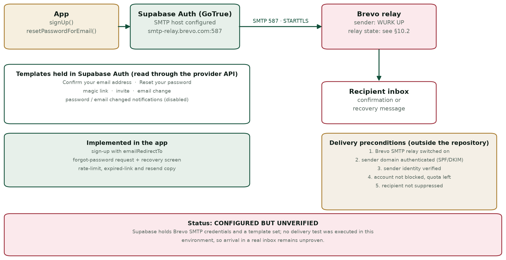

### 10.1 The direct question: who is our SMTP provider?

**Brevo.** The Supabase Auth configuration (read live through the provider API on 17 November 2026)
contains a Brevo relay:

| Setting | Value (secrets withheld) | Status |
| --- | --- | --- |
| `smtp_host` | `smtp-relay.brevo.com` | Verified active (present in config) |
| `smtp_port` | `587` (STARTTLS submission port) | Verified active |
| `smtp_user` | `c18fe0001@smtp-brevo.com` (Brevo-issued SMTP login) | Verified active |
| `smtp_pass` | **set** — value never reproduced here | Configured but unverified |
| `smtp_sender_name` | `WURK UP` | Verified active |
| `smtp_admin_email` | `sarthakjain5610@gmail.com` | Verified active |
| `smtp_max_frequency` | 60 | Verified active |

So: the application does **not** send mail itself, and the browser never talks to Brevo. Supabase Auth
takes the message, authenticates to `smtp-relay.brevo.com:587`, and Brevo delivers it.

### 10.2 Is SMTP relay enabled?

**Unknown from this environment — treat as *configured but unverified*.** Two facts must be
distinguished:

* Supabase holds a Brevo SMTP username and password. That proves credentials were issued at some
  point; it does not prove the relay switch is on.
* A previous account inspection (recorded earlier in this project) reported the Brevo account
  "Wurk up" with **SMTP relay disabled** and **no sender domain configured at that time**. Nothing in
  the repository, the Supabase configuration or this environment contradicts that, and nothing
  confirms that it has since been switched on.

Determining the current relay state requires the Brevo dashboard (Settings → SMTP & API → SMTP
relay). It cannot be derived from code, and it was **not** tested here because doing so would send
real production e-mail — an action this task explicitly forbids without authorisation.

### 10.3 Is a sender domain configured and verified?

**Unknown / not evidenced.** The only sender identity visible in configuration is
`sarthakjain5610@gmail.com` with the display name `WURK UP`. There is **no** WURK UP-owned domain
(for example `wurkup.in`) configured anywhere in the repository, in the Supabase settings or in the
Cloudflare worker configuration — the production host is a `workers.dev` subdomain. A Gmail address
used as the From address must be registered as a *verified sender* inside Brevo, and messages will
carry Gmail's domain reputation rather than the project's own.

| Question | Answer | Evidence |
| --- | --- | --- |
| Domain authenticated with SPF/DKIM in Brevo? | Unknown | requires Brevo dashboard |
| Sender identity verified in Brevo? | Unknown | requires Brevo dashboard |
| From address | `sarthakjain5610@gmail.com` (display: WURK UP) | Supabase Auth config |
| Reply-to | not set separately | Supabase Auth config |

### 10.4 Does production e-mail delivery currently work?

**Unverified.** There is no recorded successful delivery, no bounce log and no delivered message in
this project's evidence. The safe operational statement is:

> Authentication e-mails are **configured** to leave Supabase through Brevo. Whether they arrive
> depends on four things that live outside this repository: the relay switch, sender/domain
> verification, account quota/standing, and recipient acceptance. None of those was verified in this
> work.

A 30-second check the owner can run: request a password reset for a mailbox you control and watch
Brevo → Transactional → Logs for the message, then the inbox/spam folder.

### 10.5 What is implemented in the product

| Capability | Implementation | Status |
| --- | --- | --- |
| Sign-up with e-mail confirmation | `auth.signUp` + `mailer_autoconfirm = false` | Verified active (code + config) |
| "Confirm your email address" template | Supabase template with `{{ .ConfirmationURL }}` | Configured but unverified |
| Password recovery request | `resetPasswordForEmail(email, { redirectTo })` | Verified active (21 auth tests) |
| Recovery screen states (valid / expired / completed) | `PasswordRecovery.tsx` props `recoveryError`, `recoveryComplete` | Verified active (render + flow tests) |
| Resend cooldown / rate-limit messaging | client-side copy + `rate_limit_email_sent = 30`/hour | Verified active |
| Magic-link and invite templates | present in Supabase | Configured but unverified (unused by the UI) |
| Password/email-changed notifications | templates exist but notifications **disabled** | Disabled |
| Branded HTML e-mails | default Supabase templates, not customised | Planned |

### 10.6 What is still pending for e-mail

1. Enable the Brevo SMTP relay (owner action in Brevo).
2. Register and verify a sender domain (or at minimum the sender identity) and publish SPF/DKIM.
3. Run one end-to-end delivery test per workflow (signup confirmation, password reset) and record the
   message IDs.
4. Replace the default templates with branded bilingual HTML (Hindi + English) and a reply-to alias.
5. Add bounce/complaint monitoring and a support address that is not a personal mailbox.
6. Move the support/e-mail identity off a personal Gmail account before any public launch.

---

## 11. Third-party providers and integrations

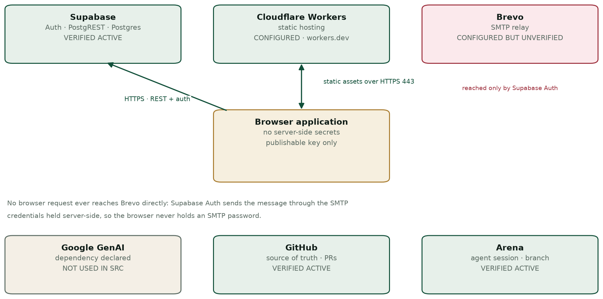

| Provider | Role | How it is reached | Status | Notes |
| --- | --- | --- | --- | --- |
| Supabase (project `qpgnoherjkvvasrwjcmf`) | auth, PostgREST, PostgreSQL 17 | browser → HTTPS, publishable key | Verified active | ap-south-1, JWT 3600 s |
| Cloudflare Workers | static hosting of `dist/` | HTTPS | Verified active | `wurkup.sarthakjain5610.workers.dev` |
| Brevo | SMTP relay for auth e-mail | Supabase Auth → SMTP 587 | Configured but unverified | relay state unknown (§10) |
| GitHub | source of truth, PRs | git/HTTPS | Verified active | PRs #11, #12 open |
| Arena | agent session and branch | — | Verified active | session branch `arena/ec593218-shramset8.0` |
| npm registry | dependency supply | build time | Verified active | lockfile committed for the app |
| Google fonts (Fontsource) | typography, self-hosted at build | none at runtime | Verified active | no external font request at runtime |
| Google GenAI (`@google/genai`) | declared dependency | never imported | Not configured | remove or wire deliberately |
| Twilio (SMS) | not used | — | Not configured | `external_phone_enabled = false` |
| Payment gateway | none | — | Not configured | no money moves through the product |
| Analytics / tracking | none | — | Not configured | no third-party script is loaded |

---

## 12. Environment variables and setup

Only three variables are read by the application. Names only — values are never committed.

| Variable | Read by | Purpose | Status |
| --- | --- | --- | --- |
| `VITE_SUPABASE_URL` | `src/services/supabase.ts` | project REST/auth endpoint | Required for cloud features |
| `VITE_SUPABASE_PUBLISHABLE_KEY` | `src/services/supabase.ts` | publishable (anon) key | Required for cloud features |
| `VITE_APP_URL` | `src/services/verifyLink.ts` | canonical origin used in generated links | Optional |

Optional/operator-only variables used by the test tooling (never by the app):

| Variable | Used by | Purpose |
| --- | --- | --- |
| `SUPABASE_DB_URL` | `npm run test:rls:live` | direct Postgres connection for the RLS SQL suite |
| `WURKUP_BASE_URL` | `npm run test:browser` | origin under test (dev/preview/production) |
| `WURKUP_WORKER_EMAIL` / `WURKUP_WORKER_PASSWORD` | `npm run test:browser` | worker account for browser verification |
| `WURKUP_CONTRACTOR_EMAIL` / `WURKUP_CONTRACTOR_PASSWORD` | `npm run test:browser` | contractor account |
| `WURKUP_SUBMIT_DISPUTE` | `npm run test:browser` | opt-in grievance submission check (disposable account only) |

Server-side secrets (**not** in this repository, deliberately): Supabase service-role key, database
password, Brevo SMTP password, JWT signing secret. `.env*` is git-ignored; only `.env.example` is
tracked.

```bash
# local setup
git clone https://github.com/sarthakjain5610/Shramset8.0
cd Shramset8.0
npm ci
cp .env.example .env.local     # then fill in the three VITE_ variables
npm run dev                    # http://localhost:3000
```

Without the two Supabase variables the app boots into local/demo mode and the dashboards render an
explicit "Supabase is not configured" state — this is intended behaviour, not a bug.

---

## 13. English/Hindi translation architecture

### 13.1 Design

| Layer | File | Mechanism |
| --- | --- | --- |
| Global UI strings | `src/services/i18n.ts` | `translations.en` / `translations.hi`, 325 keys each, `t(key, lang)` |
| Public shell | `src/services/publicCopy.ts` | nested `en`/`hi` objects, 45 leaf strings each |
| Dashboard panels | `src/components/dashboard/dashboardCopy.ts` | typed dictionary, en ⇄ hi parity enforced by the compiler |
| Inline chrome | component-local `tr(en, hi)` helpers | for labels authored next to their markup |
| Language state | `App.tsx` + `getSavedLanguage()`/`saveLanguage()` | `localStorage['shramsetu_preferred_lang']` |
| Persistence | same key | survives refresh and route changes |

`t()` falls back to the other language and then to the key itself, so a missing string can never
render `undefined` — but the audit exists precisely to make that fallback unnecessary.

### 13.2 Audit tooling (new in this work)

`scripts/i18n-audit.ts` performs two independent checks:

* **A. Dictionary integrity** — identical key sets in `en`/`hi`; no empty values; no value equal to
  its key; no Hindi value identical to English; Devanagari must not appear in English text (the
  language switch and brand tokens are allow-listed); Hindi prose must contain Devanagari; no
  `{{`/`}}` artefacts; identical `{placeholder}` sets in both languages.
* **B. Hardcoded user-facing text** — scans every `.tsx`/`.ts` file for JSX text nodes and
  user-facing attributes that are prose rather than translation lookups.

| Run | Dictionary problems | Hardcoded occurrences |
| --- | --- | --- |
| Before this work | 5 (untranslated toggles, Devanagari inside an English string) | 264 (heuristic noise) / 187 (cleaned) |
| After the public-shell pass | **0** | 120 across 21 files |
| After the dashboard and auth pass (current) | **0** | **0 — nothing left to inventory** |

Commands: `npm run test:i18n` (report) and `npm run test:i18n:strict` (fails on any hardcoded string).
Strict mode now **passes**; it stays in the suite as the ratchet that keeps new English literals from
slipping in.

### 13.3 What was corrected, and what remains

| Surface | Before | After |
| --- | --- | --- |
| Home page hero, portals, guarantees, FAQ, image alts | English literals | bilingual `tr()` values |
| Header, footer, hero pass preview | English literals | bilingual |
| About page (story, principles, welfare alignment, CTA, chips) | English only, with a "page available in English" notice | fully bilingual content arrays |
| Site-wide dictionary | 5 integrity defects | 0 defects |
| Judge Demo tour (four tabs), contact-verification dialog, Help/Contact categories and FAQ, Privacy policy sections, Not Found, Sign In / Create Account / Password Recovery shells, Worker Portal status and empty states, Contractor Dashboard roster, punch/payment/scan/dispute/audit panels, Worker Card certificate labels | English literals | bilingual `tr()` / `bi(lang, …)` values — **0 hardcoded strings remain** |

Every screen was finished in the same pattern: a `tr(en, hi)` helper (or the pre-existing
`bi(lang, en, hi)`) at the top of the component, English-only data arrays rewritten as `{ en, hi }`
records or as builder functions that take the helper, and legal or formula-bearing labels — "Section
20, Minimum Wages Act 1948", the RULE-01…07 notices, the SHA-256 chain wording — translated as whole
sentences rather than word by word, because a half-translated statute reads worse than none.

`npm run test:i18n:strict` reports **0 hardcoded user-facing strings** across `src/`, so the
remaining gap is no longer coverage but review quality: the Hindi copy is authored, consistent with
the existing dictionary, and unverified by a native proofreader (§15.4 L3).

---

## 14. Testing architecture, commands and results

### 14.1 Suites

| Suite | Command | Type | What it proves |
| --- | --- | --- | --- |
| Core | `npm test` | pure logic (no DOM) | money maths, hashing, anomaly rules, storage |
| Authentication | `npm run test:auth` | jsdom + mocked auth client | registration, sign-in, recovery, rate limits |
| Dashboard | `npm run test:dashboard` | SSR + jsdom + pure | RLS projections, copy parity, panels, grievance flow, crypto guard |
| RLS contract | `npm run test:rls` | static analysis of migrations | the 42501 class cannot return |
| RLS live | `npm run test:rls:live` | SQL against the project | real policies, real roles, real claims |
| Translation | `npm run test:i18n` | static + dictionary | key parity, language purity, hardcoded inventory |
| Screen render | `npm run test:render` | `react-dom/server` | every screen renders in both languages |
| Flows | `npm run test:ui` | jsdom interaction | navigation, forms, language switching |
| Browser | `npm run test:browser` | Puppeteer against a real origin | authenticated dashboards, 403 detection, screenshots |
| Build | `npm run build` | Vite | production bundle |

### 14.2 Results on 17 November 2026 (this branch, this environment)

| Suite | Result | Environment |
| --- | --- | --- |
| TypeScript (`tsc --noEmit`) | **0 errors** | sandbox, Node 22 |
| Core | **60 / 60** | headless |
| Authentication | **21 / 21** | headless (mock client) |
| Dashboard | **189 / 189** | headless (SSR + jsdom) |
| RLS contract (static) | **37 / 37** | headless |
| RLS live (SQL, rolled back) | **9 / 9 scenario groups** | live Supabase project |
| Translation dictionary | **0 defects**, 0 hardcoded strings (strict audit passes) | headless |
| Screen render | **13 / 13** | headless |
| Flows | **27 / 27** | headless |
| Production build | **success** | sandbox |
| Browser verification | **not executed** | no Chromium runtime available in the sandbox (missing `libnss3`); the script is provided for the team's machine |

### 14.3 Combined PR #11 + PR #12 run (previous evidence, re-verified earlier the same day)

A temporary, never-pushed worktree merged PR #11 (`f69ccc5`) and PR #12 (`231fa4f`) on top of
`main` (`d85ac8d`); the combined suite returned 60/60 core, 21/21 auth, 189/189 dashboard, 16/16
render, 29/29 flows and a successful build. The procedure is documented in
`docs/INTEGRATION_TESTING.md`; the worktree was deleted afterwards and no branch was pushed.

### 14.4 Honest gaps in test evidence

* No automated browser run in this environment (§14.2), so "renders in a real browser" rests on the
  team's manual pass.
* The dashboard suites run headless with fixtures; they prove code paths, not that a specific real
  account has data.
* E-mail delivery is untested (§10).
* The live RLS suite uses two existing worker accounts and a rolled-back assignment; it does not
  create accounts or rows that persist.

---

## 15. Security, privacy, limitations, financial-write restrictions

### 15.1 Security posture

| Control | State |
| --- | --- |
| Row Level Security | enabled on every business table (verified; a static test fails the build if a migration disables it) |
| Column-level grants | `authenticated` holds directory columns only; `user_id` never granted |
| Private identifiers | isolated in `worker_private_data`, RPC-only, no client grant |
| SECURITY DEFINER functions | `SET search_path = ''`, fully qualified bodies, boolean or owner-scoped results |
| Client secrets | none: only the publishable key ships to the browser |
| Password policy | minimum length 6 (provider default) — **weak**, see §17 |
| Sessions | JWT 3600 s, refresh-token rotation enabled |
| Signup | open (`disable_signup = false`), e-mail confirmation required |
| CAPTCHA | disabled |
| Rate limits | 30 e-mails/hour, 30 OTP verifications/hour, 150 token refreshes/hour |
| Transport | HTTPS only (Cloudflare edge) |

### 15.2 Privacy

What the QR pass encodes: an opaque reference token, an issue date and an integrity checksum.
What it never encodes: name, phone, Aadhaar, e-Shram, bank, UPI, wage balance.
Contact sharing is opt-in per worker and revocable; the contractor view shows "consent not given"
rather than a blank or a placeholder. Grievances are internal WURK UP records and every surface that
shows or creates one states, in both languages, that it is **not** a District Labour Office or
government filing.

### 15.3 Financial-write restrictions (deliberate)

There is **no** operation in the product that moves money, and none that records money as moved:

| Operation | State |
| --- | --- |
| Payout / disbursement | Not implemented — no gateway, no payout API |
| Payment confirmation by contractor | Not connected — no policy or grant exists |
| Wage-rate change | Not connected |
| Attendance writing by contractor | Not connected — attendance follows worker approval |
| Deposit / withdrawal / refund | Not implemented |
| Ledger editing or deletion | Not implemented — entries are append-only from the operator side |

The dashboards display liabilities and balances computed from ledger rows; they never assert that a
payment occurred. This is stated in the UI wherever a contractor might expect a payment action.

### 15.4 Known limitations

| # | Limitation | Impact | Mitigation |
| --- | --- | --- | --- |
| L1 | No admin/support console | operators cannot correct records through the product | deliberate: no privileged bypass exists |
| L2 | Dispute responses have no client write path | contractor response must be inserted out-of-band | documented as "Not connected" |
| L3 | Hindi copy is authored, not proofread | legal and statutory sentences could read awkwardly to a native speaker | `test:i18n` proves coverage, not quality; native review before public launch (§17) |
| L4 | No secondary database indexes | irrelevant at current volume; could degrade at scale | planned (§17) |
| L5 | E-mail delivery unverified | signup/recovery may fail silently for users | §10 checklist |
| L6 | Password minimum 6 characters | weak against guessing | raise in provider settings |
| L7 | Audit bench operates on demo data only | chain verification is not a production guarantee | labelled as demo |
| L8 | No automated browser test in CI | visual regressions can slip | `test:browser` script provided |
| L9 | `@google/genai` declared but unused | dependency surface without benefit | remove |

---

## 16. Maintenance, troubleshooting, deployment, rollback

### 16.1 Symptom → cause → action

| Symptom | Likely cause | Action |
| --- | --- | --- |
| Dashboard shows `permission denied for table workers` (42501) | a policy again filters on `workers.user_id`, or a grant was reverted | run `npm run test:rls` (static) and `npm run test:rls:live`; re-apply migration 7 |
| Dashboard shows "Supabase is not configured" | the two `VITE_` variables are missing at build time | set them and rebuild; Vite inlines env at build, not at runtime |
| Sign-up succeeds but no e-mail arrives | Brevo relay off, sender unverified, or quota exhausted | §10 checklist; check Brevo logs |
| Recovery link opens the wrong host | `site_url`/`uri_allow_list` missing the hostname | add the origin in Supabase Auth settings |
| Language resets on navigation | a component re-reads `localStorage` instead of the prop | pass `lang` down; do not re-read storage |
| Build fails on `tsc` | a new literal was added to a typed dictionary in one language only | add both `en` and `hi` keys |
| Dispute submit says "secure reference could not be created" | page served over an insecure context without Web Crypto | serve over HTTPS/localhost; never add a weak fallback |

### 16.2 Deployment

```bash
npm ci && npm run build      # dist/ is the deployable artefact
npx wrangler deploy          # uploads dist/ as static assets (owner action)
```

Post-deploy smoke: open the production URL, switch to Hindi and back, sign in, open both dashboards,
confirm no "permission denied" appears in the network tab. `npm run test:browser` automates exactly
this against any origin.

### 16.3 Rollback

| Situation | Rollback |
| --- | --- |
| Bad frontend deploy | redeploy the previous `dist/` (Cloudflare keeps version history) |
| Bad migration | apply a new forward migration that restores the previous policy definitions; never edit an applied migration |
| 42501 returns | re-apply `20261117120000_worker_identity_rls_helpers.sql` (idempotent) |
| Suspected data incident | restore from the Supabase project backup; do not run destructive SQL |

Migration 7 is idempotent (`CREATE OR REPLACE`, `DROP POLICY IF EXISTS … CREATE POLICY`), so
re-running it is safe; migrations 1–6 are not to be touched.

---

## 17. Pending features, disabled functionality and roadmap

| Item | Category | Current state | Next step |
| --- | --- | --- | --- |
| Hindi proofreading | translation quality | coverage complete (0 hardcoded strings), copy unreviewed | native-speaker review of the statutory and grievance wording |
| Brevo relay + sender domain | operations | configured but unverified | enable relay, verify domain, publish SPF/DKIM |
| Branded bilingual e-mail templates | product | default templates | author Hindi/English HTML |
| Password policy | security | 6-character minimum | raise to 10 + HIBP check |
| CAPTCHA on signup | security | disabled | enable if abuse appears |
| Secondary indexes (`worker_id, date`) | performance | absent | add when row counts justify |
| Contractor dispute response | product | not connected | needs a policy + RPC + tests |
| Attendance writing by contractor | product | not connected | needs an approval-driven RPC |
| Admin/support console | product | absent | design with audit trail before building |
| Remove `@google/genai` | maintenance | declared, unused | delete or wire deliberately |
| Automated browser CI | testing | manual script | run `test:browser` in a pipeline with a Chromium image |
| Custom domain | infrastructure | `workers.dev` only | add domain in Cloudflare + Supabase allow-list |
| Judge Demo move to a dedicated route guard | hardening | explicit entry | optional |

Disabled-by-configuration (verified): phone/SMS auth, social providers, SAML, MFA (TOTP enabled but
unused by the UI), e-mail change notifications, CAPTCHA, anonymous sign-in.

---

## 18. Glossary, references and change history

### 18.1 Glossary

| Term | Meaning |
| --- | --- |
| Muster roll | the attendance register of a site; historically kept by the contractor |
| Paise / integer paise | money stored as an integer number of paise (₹1 = 100 paise) to avoid float error |
| RLS | Row Level Security — PostgreSQL row filters per role |
| Policy subquery | an `EXISTS (…)` clause inside a policy; runs with the caller's privileges |
| Column grant | `GRANT SELECT (col, …) ON table TO role` — the mechanism that keeps `user_id` private |
| SECURITY DEFINER | a function that executes with its owner's privileges |
| Hash chain | each record stores the hash of its predecessor; altering history breaks the chain |
| Approval handshake | the two-step shift confirmation between contractor and worker |
| WU-DSP reference | `WU-DSP-YYYYMMDD-XXXXXXXXXX`, an internal WURK UP record id (not a government filing) |
| Judge demo | an isolated dataset used for evaluation, never mixed with real accounts |

### 18.2 References

* Repository `sarthakjain5610/Shramset8.0`; branch `arena/ec593218-shramset8-0`.
* `docs/DASHBOARD.md` — dashboard architecture and data contract.
* `docs/INTEGRATION_TESTING.md` — the temporary combined-testing procedure.
* `docs/AI_HANDOFF.md` — chronological engineering handoff notes.
* `supabase/migrations/*.sql` — the authoritative schema definition.
* `supabase/tests/rls_permissions.sql` — the live permission regression suite.
* MP Minimum Wages Act 1948 (statutory wage bands used by the engine).

### 18.3 Change history

| Version | Date | Change |
| --- | --- | --- |
| 0.x | 2026-10-25 → 2026-11-02 | baseline schema, private-data split, RPCs, onboarding |
| PR #12 `e3b4817` | 2026-11-17 | Worker and Contractor dashboards on live Supabase |
| PR #12 `2fd71a4` | 2026-11-17 | grievance reference → internal `WU-DSP-…`, bilingual disclaimers |
| PR #12 `8d473fc` | 2026-11-17 | wage benchmark note softened |
| PR #12 `231fa4f` | 2026-11-17 | Web Crypto required; no `Math.random` fallback |
| v1.0 (this work) | 2026-11-17 | 42501 fix + migration 7, RLS suites, translation audit + public-page Hindi, this manual |

---

## Appendix A — repository file map (abridged)

| Path | Contents |
| --- | --- |
| `src/App.tsx` | root shell: routes, language, auth, modals |
| `src/components/public/*` | Home, HowItWorks, About, Privacy, HelpContact, SignIn, CreateAccount, PasswordRecovery, VerifyPass, NotFound, AuthLayout |
| `src/components/dashboard/*` | shell, UI kit, typed copy, 6 worker + 7 contractor panels |
| `src/components/dashboard/worker|contractor/*` | panel implementations |
| `src/components/*.tsx` | judge-demo modal, worker/contractor portals, modals, hero, header, footer |
| `src/services/*` | auth, supabase client, dashboard data/analytics, i18n, copy, engines, storage, router |
| `scripts/*` | test suites (`run-all-tests`, `auth-registration-test`, `dashboard-test`, `smoke-render`, `flow-test`), `i18n-audit`, `rls-contract-test`, `browser-verify`, figure generator |
| `supabase/migrations/*` | 7 SQL migrations |
| `supabase/tests/rls_permissions.sql` | live RLS regression suite |
| `docs/*` | dashboard, integration, handoff, this manual |
| `wrangler.jsonc` | Cloudflare Workers static-asset configuration |

## Appendix B — incident record: the 42501 dashboard outage

**Reported symptom.** The live dashboard showed
`{"code":"42501","hint":"Grant the required privileges to the current role with: GRANT SELECT ON public.workers TO authenticated;","message":"permission denied for table workers"}`.

**Investigation.** (1) Read column privileges for `authenticated`: `workers` had directory columns only,
`user_id` excluded by design. (2) Read all 12 policies: six of them on four tables embedded
`EXISTS (SELECT 1 FROM workers w WHERE w.user_id = auth.uid())`. (3) Reproduced with the exact role and
claims PostgREST uses:

```
SET LOCAL ROLE authenticated;
SET LOCAL request.jwt.claims = '{"sub":"<worker uuid>","role":"authenticated"}';
workers=OK       attendance=42501  ledger=42501  disputes=42501
approvals=42501  sites=OK  assignments=OK
```

**Root cause.** Policy subqueries execute with the calling role's privileges. Migration 3 revoked
`workers.user_id` from `authenticated`, so those six policies could not be evaluated — every read of
the four tables failed, while `workers` itself read fine. The hint (grant table-wide SELECT) would
have "fixed" it by exposing `user_id` to every authenticated user; it was not followed.

**Fix.** Migration 7 adds three `SECURITY DEFINER` boolean predicates and rewrites the six policies to
call them. No grant widened, no RLS disabled, no data touched.

**Verification.** Re-ran the same probe: all tables OK. Ran the nine-group RLS suite (worker,
assigned contractor via a rolled-back assignment, unrelated account, own/foreign dispute insert,
private-column denial): all passed. 37 static contract checks pass. The application code needed no
change.

**Residual risk.** A future policy author could reintroduce a `workers.user_id` subquery; the static
contract test now fails the build if that happens.

## Appendix C — indexes of figures and tables

**Figures** (numbered in order of appearance; each is regenerated by
`docs/technical/figures/generate_figures.py`).

1 Overall system architecture · 2 Frontend component and routing structure · 3 Registration and
authentication flow · 4 Password recovery flow · 5 Database entity-relationship diagram · 6 RLS and
role-permission model · 7 Worker onboarding flow · 8 Worker dashboard data flow · 9 Contractor
dashboard data flow · 10 GitHub, Arena, build and deployment workflow · 11 SMTP and e-mail delivery
architecture · 12 Third-party provider integration map.

**Tables.** Tables carry a section number in the heading above them (for example §6.2) and are
numbered sequentially in the PDF. Index by topic: 1.2 objectives · 1.3 roles · 1.5 timeline · 2.1 layers · 2.2 routes ·
2.4 dependencies · 3.1 components · 3.3 API calls · 4.1 tables · 4.2 functions · 4.3 triggers ·
4.4 constraints · 5 migrations · 5.3 before/after probe · 6.2 policies · 6.3 column grants ·
6.4 consent · 7.2 worker flow · 7.3 contractor flow · 8 modules · 8.2 hosting · 9.4 auth URLs ·
10.1 SMTP · 10.3 sender · 10.5 e-mail capability · 11 providers · 12 environment variables ·
13.2 audit results · 14.1 suites · 14.2 results · 15.1 security · 15.3 financial writes ·
15.4 limitations · 16.1 troubleshooting · 17 roadmap.
### C.1 Deliberately not verified in this session

These three items are the complete list of claims this manual does **not** make. They are recorded
so that no reader mistakes configuration for proof.

- **Real e-mail delivery** — not tested, because it would send production mail and the Brevo
  dashboard was not accessed. *To verify:* request one password reset and read Brevo →
  Transactional → Logs.
- **Browser rendering of both dashboards** — not executed, because no Chromium runtime can be
  installed in this sandbox. *To verify:* `npm run test:browser` on a machine with Chromium, once as
  a worker and once as a contractor.
- **Live production deployment** — not performed, by design. *To verify:* open the production URL,
  sign in, and confirm no 42501 appears in the network tab.

### C.2 Verification evidence (verified in this session)

Every factual claim in this manual is attached to one of the checks below. Nothing here is
asserted from memory or from a previous run of a different commit.

| Claim | How it was verified | Date | Result |
| --- | --- | --- | --- |
| Migration history matches the repository | `supabase_migrations.schema_migrations` read through the provider API: 7 rows, names equal to the 7 file names | 2026-11-17 | Verified |
| Root cause of the 42501 outage | `SET LOCAL ROLE authenticated` + `request.jwt.claims`, per-table SQLSTATE capture, before and after migration 7 | 2026-11-17 | Verified |
| Policy set and column grants as documented | `pg_policies`, `column_privileges`, `information_schema.columns` reads | 2026-11-17 | Verified |
| Worker / assigned contractor / unrelated account behaviour | `supabase/tests/rls_permissions.sql`, 9 scenario groups in a rolled-back transaction | 2026-11-17 | Verified (all passed) |
| Policies cannot silently regress | `npm run test:rls` — 37 static checks over the migration files | 2026-11-17 | Verified (37/37) |
| Type safety and build | `npx tsc --noEmit`, `npm run build` | 2026-11-17 | Verified (0 errors, build succeeds) |
| Screen, flow and dashboard behaviour | `npm run test:render`, `test:ui`, `test:dashboard` (13 / 27 / 189 checks) | 2026-11-17 | Verified (all passed) |
| Translation dictionary integrity | `npm run test:i18n` and `test:i18n:strict` (key parity, script purity, hardcoded-string inventory) | 2026-11-17 | Verified (0 dictionary defects, 0 hardcoded strings) |
| Auth, SMTP and redirect configuration | Supabase Auth configuration read through the provider API | 2026-11-17 | Verified (values recorded, secrets omitted) |

